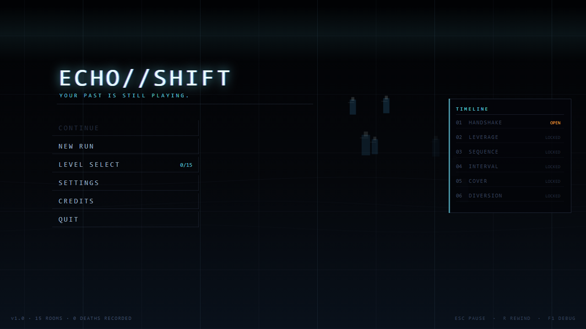
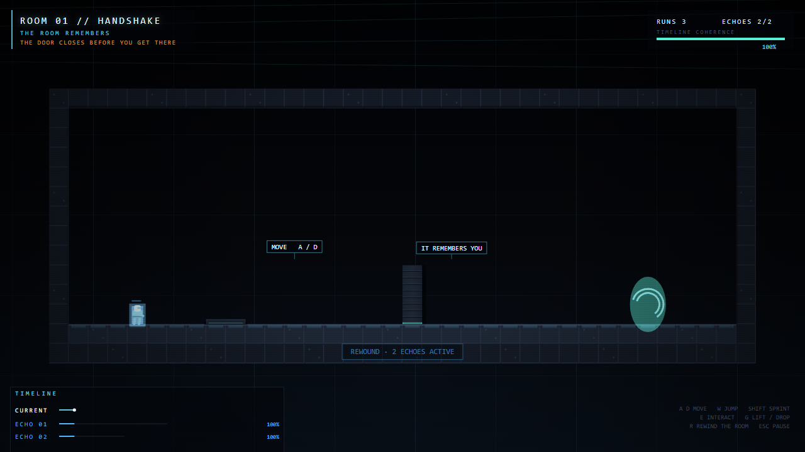
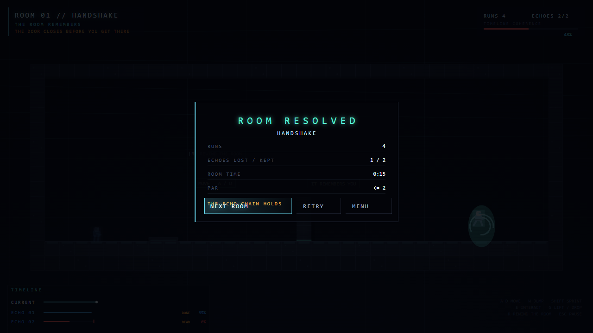
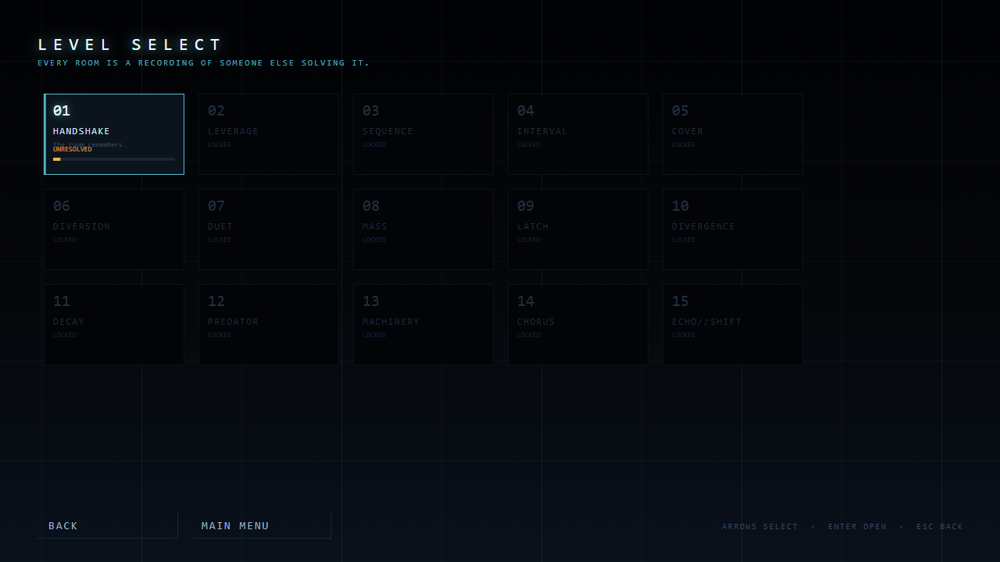
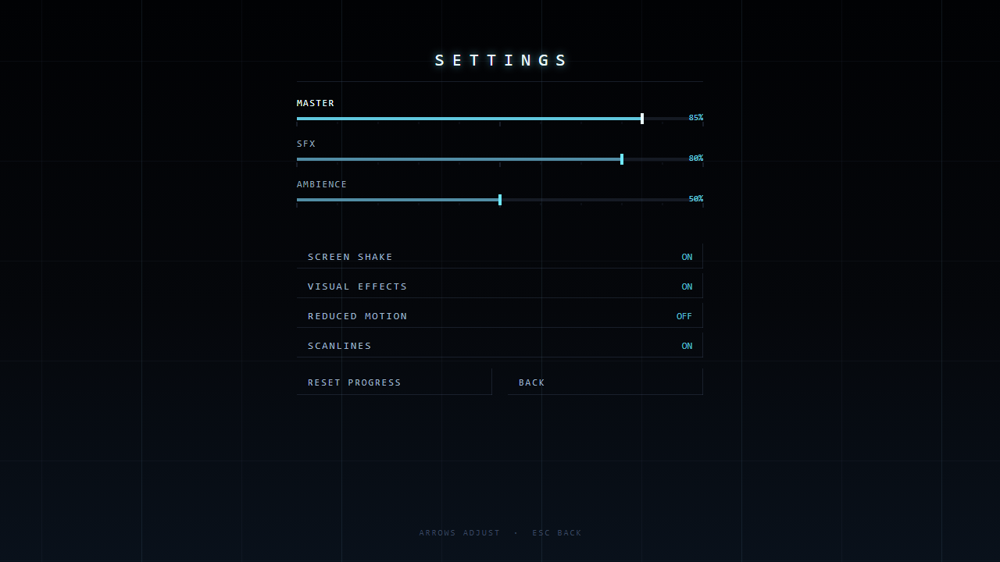
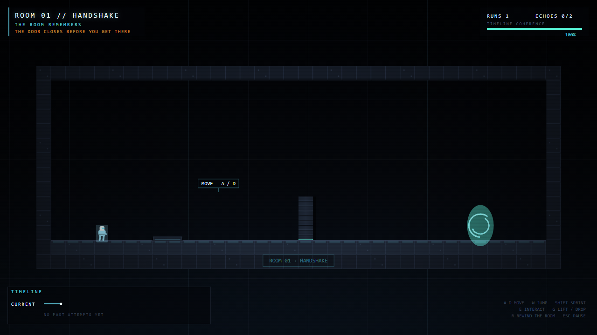
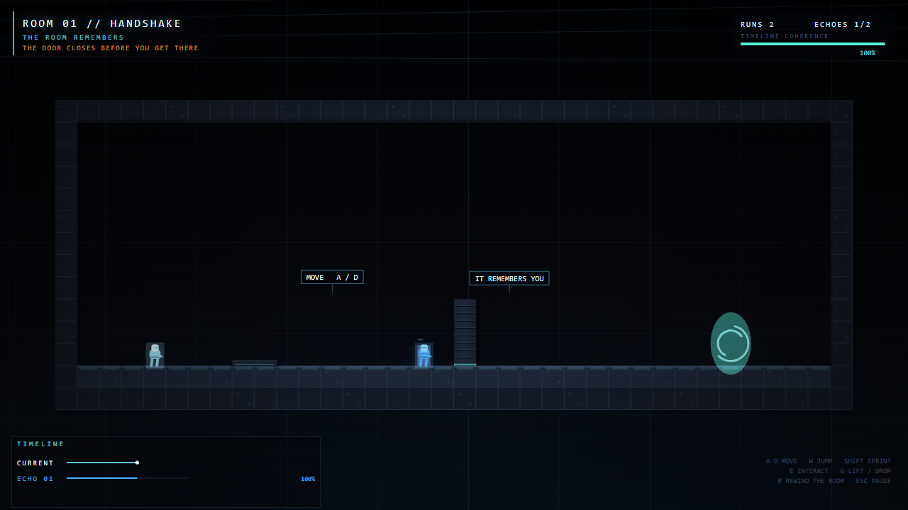
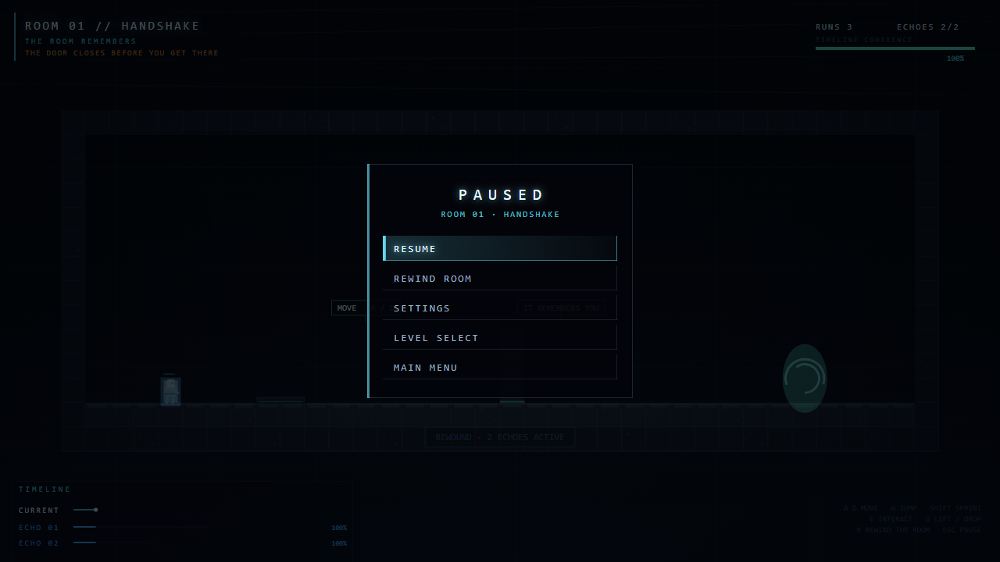

# ECHO//SHIFT

**Your past selves are part of the solution.**

A 2D sci-fi temporal puzzle game. Every time you restart a room, your previous
attempt comes back as an **Echo** — a deterministic replay of everything you just
did. The plate you stood on stays held. The door you opened stays open. The guard
you distracted stays distracted. The puzzle is never *"what do I do?"*, it is
*"what do we do, across time?"*

Zero binary assets. Zero runtime dependencies. Everything — art, animation,
sound, music — is generated in code at runtime: Canvas2D rendering and
procedural WebAudio on top of a fixed-timestep deterministic simulation.



---

## Run it

Prerequisites: Node.js 18+ and npm. No other dependencies at runtime.

```bash
npm install
npm run dev        # http://localhost:4173
```

Production build and static preview:

```bash
npm run build      # -> dist/
npm run preview    # serves dist on :4180
```

Tests:

```bash
npm test           # headless sim harness: 40 checks (all 15 levels + determinism)
npm run test:browser  # headless Chrome QA: 24 checks + screenshots/ (needs Chrome; override with CHROME_PATH)
npm run verify     # headless suite + production build
```

## Controls

| Action        | Keys                          |
| ------------- | ----------------------------- |
| Move          | `←` `→` / `A` `D`             |
| Jump          | `Z` / `Space` (hold = higher) |
| Sprint        | `Shift`                       |
| Interact      | `E`                           |
| Grab / throw  | `G`                           |
| **Rewind**    | `R` (restarts room, spawns your Echo) |
| Pause         | `Esc`                         |
| Debug overlay | `F1`                          |
| Menus         | Arrows + `Enter`, `Esc` back, mouse also works |

## The loop

1. Enter a room. Read the objective.
2. Do as much as you can. You will probably fail — that is the point.
3. Press **R**. Your failed attempt becomes Echo 01 and replays alongside you,
   forever, exactly as you played it.
4. Choreograph: let your past self hold the plate while your present self walks
   through the door. Rewind again for Echo 02, 03…
5. Reach the exit inside the par to earn an **OPTIMAL TIMELINE**.




## Features

- **15 hand-designed rooms**, each proven solvable by the automated harness —
  from a one-plate tutorial (`HANDSHAKE`) to multi-timeline finales
  (`CHORUS`, `ECHO//SHIFT`).
- **Deterministic echo replay.** Attempts are recorded as delta-encoded input
  masks and replayed through the *same* character code path as the live player.
  No snapshots, no video — just inputs and a seed.
- **Multiple coexisting echoes** with per-echo **timeline coherence**
  (divergence from the original recording is measured continuously and shown in
  the HUD).
- **Corrupted echoes**: echoes that took too much temporal damage loop their own
  recordings — useful, unpredictable, visibly glitched (RGB split + scanline
  displacement).
- **Temporal gates** that only open while *n* echoes are present, and
  **dampener fields** that stabilise echoes and repel hunters.
- **Machines**: pressure plates, buttons, switches, doors, crates (carry &
  throw), lasers that stop at bodies, moving platforms with dwell timing.
- **Enemies**: patrolling **guards** with vision cones, **hunters** that chase
  the nearest timeline (echoes are tempting targets), and rotating
  **sentinels** that sweep a beam.
- **Full shell**: main menu, level select with per-room records, settings
  (volumes, shake, VFX, reduced motion, scanlines), pause, death & completion
  screens with run stats and par, credits, localStorage saves.
- **Procedural audio**: every sound effect is synthesized WebAudio (no samples),
  plus a per-room ambient drone on a filtered echo bus.
- **Settings & progression persist** across reloads.

## Architecture

```
index.html            boot shell + styles
src/
  sim/                deterministic core — no DOM, no Math.random, no Date
    constants.js  math.js  prng.js (xorshift32, world-seeded)
    input.js      bitmasks for buttons + delta-encoded held state
    level.js      def -> tiles/objects/entities
    world.js      fixed 60Hz tick order, event bus (onEvent) for presentation
    entities.js   shared physics/AI for player AND echoes
    objects.js    plates, doors, boxes, lasers, platforms, gates, dampeners…
    ai.js         guard / hunter / sentinel behaviours
    recorder.js   attempt -> delta input rows (+ fingerprint)
    replayer.js   rows -> input, bit-identical
    echo.js       echo entity: replay + divergence + corruption
    echoManager.js  attempt -> echo lifecycle
    divergence.js trace sampling + coherence measure
  app/
    session.js    attempt lifecycle shared by game and tests
    save.js       localStorage settings + progression
  levels/index.js  15 level defs (single source of truth for game & tests)
  render/          palette, camera (damped follow, look-ahead, shake),
                   particles, renderer (bakeStatic, echoes, corruption FX)
  audio/audio.js   procedural synth: ~25 one-shots + ambient
  ui/ui.js         immediate-mode canvas UI (menus, HUD, timeline, toasts)
  main.js          scene machine, fixed-timestep loop, input mapping
tests/
  headless.js      40 checks: level validation, scripted solutions, determinism
  solutions.js     frame-exact input scripts that beat every room
  probe.js         interactive sim debugger (node tests/probe.js <lvl>)
  browser-qa.js    headless Chrome pass: scenes, echoes, pause, completion
```

### Why determinism is the whole game

An echo is only trustworthy if it is *exactly* what you did. So the simulation
is a pure function of (level seed, input stream):

- fixed 60 Hz accumulator loop, one documented tick order in `world.js`
- `Math.random` / `Date.now` are banned in `src/sim/`; a seeded xorshift32 `Rng`
  drives anything stochastic (sparks, AI jitter), seeded from the world seed
- the player and every echo run through `entities.js` — the same `stepActor()`
  with different input sources (`InputDevice` live vs `Replayer` recorded)
- the recorder stores delta-encoded held-bit rows; replay recomputes
  `pressed` from consecutive rows, so edge-triggered actions (jump, interact)
  fire on exactly the same tick

The harness proves it: every level's scripted solution is replayed headlessly
and must reach `world.complete`, and re-running identical input streams must
produce bit-identical states (`tests/headless.js`).

### Presentation is a subscriber, not a driver

`world.pushEvent()` emits semantic events (`PLATE_DOWN`, `DOOR_OPEN`,
`PLAYER_DEATH`, `LEVEL_COMPLETE`…) to `onEvent`, which only feeds audio, VFX,
screen shake and toasts. The simulation never reads it back, so nothing
visual can desync the timelines.

## Testing & QA

- `npm test` — 40/40: validates all 15 level definitions, plays all 15 rooms
  with frame-exact scripts, checks determinism across runs, and asserts
  mechanics (echo-on-plate holds door, gate needs N echoes, laser body
  blocking, box physics, platform carry, divergence measurement).
- `npm run test:browser` — 24/24 in headless Chrome: boots the real page,
  walks every scene with real keyboard events, creates and observes echoes,
  pauses/resumes, dies and auto-rewinds, completes a room, unlocks the next,
  verifies settings persistence and asserts **zero console/page errors**.
  Writes the `screenshots/` you see above.

## Technical challenges

- **Bit-exact replay across contexts.** Floating-point physics plus
  edge-triggered input is where most replay systems rot. Solving it meant
  removing every hidden input (timers, RNG) from the sim and deriving
  `pressed` from the recording rather than from wall-clock state.
- **Echoes as first-class bodies.** Echoes collide with the player, hold
  plates, carry boxes and occlude lasers — but must never make the room
  unsolvable. Ordering is fixed: objects read `pressBodies` computed in the
  same tick, echoes update before `postUpdate` resolution.
- **Divergence without video.** Coherence is measured by sampling per-tick
  traces at a fixed interval and comparing positions/contacts, giving the HUD a
  stable % and letting corrupted echoes degrade gracefully instead of snapping.
- **Rendering 15 rooms cheaply.** Static tiles are baked once per room into an
  offscreen canvas; only characters, dynamic objects and FX redraw per frame.
- **Readable UI on a dark stage.** One rule: strongest accent = the player,
  translucent accent = echoes, restrained red/orange = danger — enforced
  through a palette table shared by renderer, UI and audio intensity.

## Screenshots

| | |
| --- | --- |
|  |  |
|  |  |
|  |  |

## Future improvements

- Ghost-free level editor with the same scripted-solution validator as CI.
- Daily seeded rooms with a shared replay file (the recorder already serialises).
- Co-op: two input streams into one deterministic world.
- Speedrun leaderboard fields (room time, deaths, echoes kept) — stats are
  already recorded per room.

MIT-licensed. Built with Vite + Canvas2D + WebAudio.
